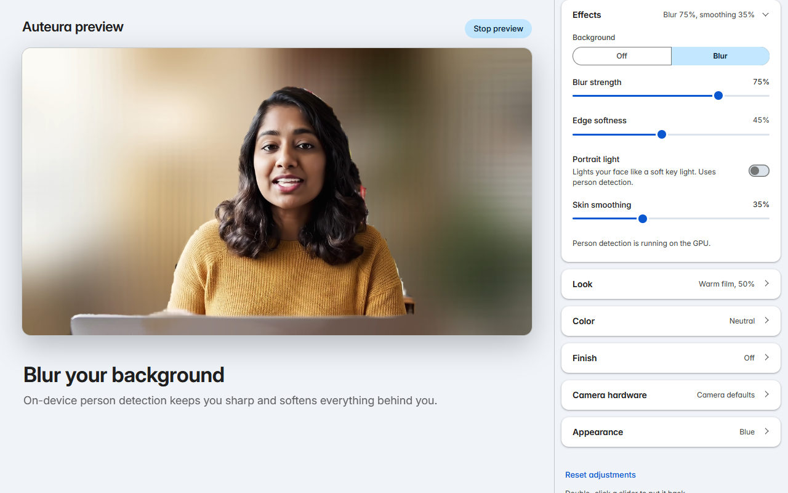

# Auteura

Auteura is a virtual camera for Chrome and ChromeOS. It adds a camera named **Auteura Virtual Camera** to every website’s camera list, and whatever you pick there gets background blur, zoom and framing, LUT looks, color grading, and direct control of your webcam’s own settings. Everything is processed on your device.

## What it does

- **Background** — blurs everything that isn’t you, with adjustable strength and edge softness. **Portrait light** adds a soft light on you, and **Skin smoothing** touches only the person.
- **Framing** — digital zoom up to 4×, position, mirroring, and **Follow me**, which keeps you centered while zoomed in.
- **Look** — six built-in 3D LUTs, or import your own `.cube` file, with an intensity slider.
- **Color** — exposure, contrast, highlights, shadows, temperature, tint, and saturation.
- **Finish** — sharpening, vignette, and film grain.
- **Camera hardware** — whatever your webcam exposes to Chrome: exposure, shutter, ISO, white balance, focus, and, on motorized cameras, pan, tilt, and zoom.
- **Your own color** — match the panel and toolbar icon to your Chrome theme with swatches, a color picker, or the eyedropper.

Changes apply to every site using the camera within a frame or two. **Open preview** shows the same picture in its own tab, so you can set things up without joining a call.

## Install

Install Auteura from the Chrome Web Store (the link will be here once the listing is live). It needs Chrome 116 or newer and no `chrome://flags`.

Pin the toolbar icon if you like; clicking it opens the controls in Chrome’s side panel.

## Use

Open any video site — Google Meet, Zoom or Teams on the web, Discord, Jitsi. With **Default camera for sites** on, a site that asks for “a camera” gets Auteura automatically. With it off, choose **Auteura Virtual Camera** in the site’s own camera menu. The site asks for camera permission as usual, and Auteura runs under that same permission.

While a site is using the virtual camera, the side panel’s header shows where (“Live in meet.google.com”) and the toolbar icon shows a LIVE badge.

## Where it works

Auteura works for anything that runs in Chrome: websites in tabs and installed web apps. It doesn’t appear in desktop apps (the Zoom or Teams apps, OBS), Android apps, Linux apps, or the ChromeOS Camera app, because those don’t use Chrome’s camera APIs.

If you use ChromeOS’s own video effects (background blur, portrait relighting in the quick settings tray), turn off the ones Auteura also does, so the picture isn’t blurred twice.

## Troubleshooting

- **A site doesn’t list the virtual camera.** Reload the tab after installing or updating Auteura; pages that were already open don’t have it yet. The site needs to be on `https://` (or `localhost`).
- **The picture is black or frozen.** Check that no app outside Chrome is holding the camera, then stop and restart video in the site.
- **A site shows your real camera instead.** It asked for a specific camera. Choose Auteura Virtual Camera in that site’s settings.
- **Background blur never starts.** The panel’s Background section says why.

Something else? [Open an issue](https://github.com/phlthydelphya/auteura-extension/issues).

## Privacy

All processing happens on your device. Auteura has no servers, no accounts, and no analytics, and it makes no network requests of its own. See the [privacy policy](PRIVACY.md).

## Credits

Person detection uses Google’s MediaPipe Selfie Segmenter (Apache License 2.0), bundled in the extension with its usage telemetry blocked. The interface typeface is Inter (SIL Open Font License 1.1).
